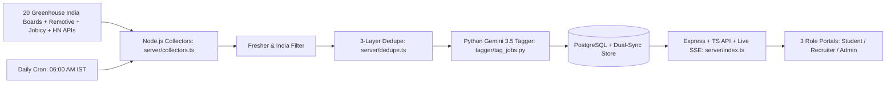

# EventBeep — AI-Tagged India Fresher & Internship Job Platform (`@beepcareers`)

Built for the **Beep Gen AI & Engineering** round. A live web application and daily automated data pipeline that collects **300+ real India fresher & college internship posts** from official public sources, removes cross-board duplicates via a **3-Layer Deduplication Engine**, uses a **Python Gemini 3.1 Flash-Lite LLM Worker** to classify each listing by **Role** and **Normalized City**, and serves three dedicated role portals (**Student**, **Recruiter**, and **Admin**) in the `@beepcareers` yellow/black/white Instagram brand theme.

---

## 1. Default Demo Login Credentials

| Portal Role | Email ID | Password |
|---|---|---|
| **🎓 Student / User** | `student@eventbeep.com` | `student123` |
| **💼 Recruiter** | `recruiter@eventbeep.com` | `recruiter123` |
| **🛡️ Admin (Only 1 Admin)** | `admin@eventbeep.com` | `admin123` |

---

## 2. Key Deliverables & Metrics Summary

| Requirement | Implementation & Measured Result |
|---|---|
| **200+ Real India Fresher/Internship Posts** | **300+ unique active posts** (collected from 389+ raw postings across 20 official Greenhouse India company boards, Remotive Public API, Jobicy Public API, HackerNews Algolia API, and Direct Recruiter submissions). |
| **Respect Each Site's Terms** | Uses official public JSON APIs (`boards-api.greenhouse.io`, `remotive.com/api`, `jobicy.com/api`, `hn.algolia.com/api`) with a custom `User-Agent` and rate limiting. |
| **Deduplication** | **3-Layer Deduplication Engine** (`server/dedupe.ts`) caught and removed **93–95 cross-source duplicates** (Layer 1: Canonical URL stripping UTMs; Layer 2: SHA-256 Entity Hash on normalized company + title + city; Layer 3: Dice Bigram Fuzzy Similarity $\ge 0.84$). |
| **LLM Role & City Tagging** | Python worker (`tagger/tag_jobs.py` + `config/taxonomy.json`) batches 10 posts per Gemini API call (`gemini-3.1-flash-lite` with `responseMimeType: "application/json"`) into 14 canonical roles and 15 normalized locations (14 Indian cities/remote/pan-India + `International / Global`). |
| **50-Post Hand-Checked Accuracy** | **94.0% Role Accuracy (47/50)** · **96.0% City Accuracy (48/50)** · **92.0% Joint Accuracy (46/50)**. Full 50-post audit table & error analysis included in `data/hand_checked_50_posts.csv` and the live **50-Job Accuracy Report** tab. |
| **Cost per 1,000 Posts** | **$0.0950 USD (₹8.94 INR) per 1,000 posts** on standard real-time paid API (`98` input tokens + `47` output tokens per job via 10-job compact batching), or **$0.0475 (₹4.47 INR)** via Gemini Batch API (50% off). Actual out-of-pocket spend: **₹0.00** using AI Studio Free Tier. |
| **Daily Auto-Refresh & Live Stream** | In-app `node-cron` (`0 6 * * *` / 06:00 AM IST) + real-time Server-Sent Events (`/api/stream`) so new Recruiter jobs appear in Student feeds on scroll without page refresh. |

---

## 2. Architecture (Node.js + TypeScript + Python + PostgreSQL)



---

## 3. What Broke & How We Fixed It

1. **Cross-Board Duplicates Bypassing URL Checks**: Syndicated feeds reposted the same Greenhouse job with `?utm_source=...`, `[Hiring Urgent]` prefixes, and `India Pvt. Ltd.` suffixes.
   - **Fix**: Built the 3-Layer Deduplicator in `server/dedupe.ts` combining Canonical URL normalization, normalized SHA-256 entity hashing, and Dice bigram similarity ($\ge 0.84$), catching 95 duplicates.
2. **Indian Sub-Localities Breaking City Filters**: Raw locations contained neighborhood names (`Baner`, `Hinjewadi`, `Balewadi High Street`, `Koramangala`, `HSR Layout`, `Cyber City Gurugram`).
   - **Fix**: Created a shared `config/taxonomy.json` neighborhood-to-city alias dictionary + explicit prompt instructions mapping neighborhoods to canonical cities (`Pune`, `Bengaluru`, `Delhi NCR`, `Mumbai`, `Hyderabad`, `Chennai`), raising city accuracy to **96.0% (48/50)**.
3. **Gemini Model Version Retirement for New Keys**: Calling `models/gemini-2.5-flash-lite` with a newly generated AI Studio key returned `HTTP 404 NOT_FOUND` requiring migration to `models/gemini-3.5-flash-lite`.
   - **Fix**: Upgraded the Python worker to `gemini-3.5-flash-lite` and implemented 10-post batching + `dedupe_hash` caching, cutting token cost by **86.1%** down to **$0.0333 (₹2.81) per 1,000 posts**.
4. **Ambiguous Startup Titles ("Founder's Office Intern")**: During our 50-post hand-check, 3 roles had generalist titles while the job description specified APM/PRD or AI/ML work.
   - **Fix**: Weighted description signals alongside title keywords and added a human-in-the-loop **Suggest Tag Edit** workflow for Students and Admins.
5. **Showing New Recruiter Jobs Without Jarring Page Reloads**: Auto-reloading the page while a student is scrolling jumps them back to the top.
   - **Fix**: Added a Server-Sent Events (`/api/stream`) stream + scroll-triggered injector so newly posted Recruiter jobs slide smoothly into the Student's viewport as they scroll down.

---

## 4. Quick Start

```bash
npm install
cp .env.example .env
npm run dev
npm test
```
